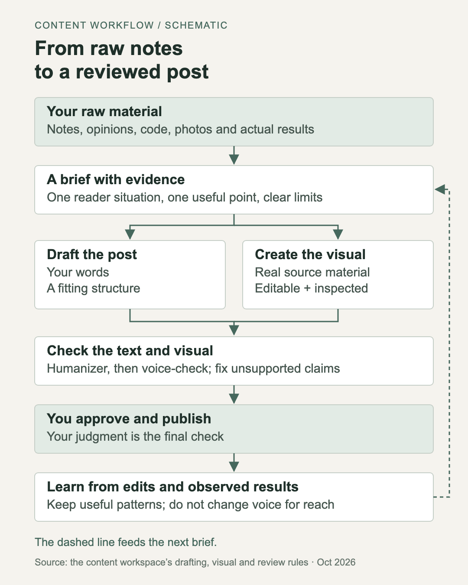

# Content Strategist

Turns your notes into LinkedIn, X, Threads and Bluesky posts that sound like you, makes the visuals and schedules the posts. It runs in Claude Code or Codex.

Built by Diana Dobra on the setup of Maja Voje's [GTM Strategist skills](https://github.com/GTM-Strategist/gtm-strategist-skills): skills, context files you fill in once, and every output saved in the repo.



## Start here

1. **Open it.** Clone the repo and open the folder in Claude Code. You need Python 3. Optional: Node 18+ and ffmpeg for animations, Google Chrome on macOS for carousels, and a Zernio account for scheduling.
2. **Train it on your voice.** Paste 10–20 of your posts, a few messages or emails, and transcripts of voice memos, then say "train my voice with these". Voice memos show how you explain things when you aren't polishing them. Mark your favorite posts `best`.
3. **Fill in your positioning.** Say "help me fill in my positioning" (`strategy/positioning.md`). If you're building a product, also fill in `strategy/product.md`: what posts can and can't say about it.
4. **Optional: scheduling.** Run `claude mcp add --transport http zernio https://mcp.zernio.com/mcp`, then `/mcp` → zernio → Authenticate. The first "schedule the posts" asks which accounts to use.
5. **Optional: your brand.** Carousels and animations use the brand of BlinkWrite, Diana's product. Put your colours and fonts in `outputs/visuals/carousel-kit/kit.css` and `.claude/skills/motion-graphics-builder/template/index.html`.

## How a post gets made

LinkedIn is the main channel, so every post starts there:

1. **Idea.** "idea: ..." saves your words as they are. Nothing gets written yet.
2. **Brief.** It picks one reader and one takeaway, asks you for what's missing and checks each fact against its source. If your notes get a fact wrong, it fixes it and tells you.
3. **Draft.** Your words, in a known format (`references/formats.md`), with one feeling the post should give the reader (`references/psychology.md`). It suggests up to three openings and shows where LinkedIn cuts each one on mobile.
4. **Check.** A humanizer, then a voice check against your voice guide and banned words.
5. **Approve.** Nothing goes out without you. Drafts stay in `outputs/posts/drafts/` until you've reviewed them and say "mark it ready". Then it splits the post by channel into `outputs/posts/ready/`. Only ready posts get scheduled.

Around that:

- **X, Threads and Bluesky** come second. They get shorter versions, one point per post, in publicly known formats.
- **Visuals** come from real material: a diagram, a chart, a document excerpt, a two-page carousel or a short animation (`motion-graphics-builder` renders an MP4, a GIF and a still).
- **Scheduling** goes through Zernio. LinkedIn goes out first, and nothing is ever published right away.
- **Learning.** Paste what you actually posted, or correct a draft ("too corporate"), and it updates your voice guide. `study-creator` takes formats from other creators' posts, never their words.

## Everyday use

| Say | What you get |
|---|---|
| "idea: ..." | the idea saved word for word |
| "write a post about ..." or your notes | a brief, a LinkedIn draft and hooks |
| "what should I post next?" | a short list from your ideas |
| "put this on X / Threads / Bluesky" | versions for those channels |
| "does this sound like me?" | small edits you can reject |
| "mark it ready", once you've reviewed a draft | the post split by channel into the ready queue |
| "make a visual", "make a carousel", "animate this" | the visual and its editable source |
| "schedule the posts" | the posts scheduled in Zernio |
| "here's what I actually posted" | your edits added to the voice guide |
| "I posted it" | the post moved to `published/` and logged |
| "study this creator" | their post formats, never their content |

## Examples

`examples/` has Diana's real results. The skills use them as references only, never as your posts or your voice.

- **Voice:** Diana's voice guide, banned words and part of the feedback log.
- **7 posts** with their X, Threads and Bluesky versions: 4 published, 3 approved and waiting in the queue.
- **Visuals:** two carousels, the Figma → React animation, and court-filing excerpts made with a script.
- **A full trail:** `examples/ideas/used/2026-10-21-character-ai-bankruptcy.md` goes from the raw notes to the checked facts, the hooks and the edits.

## Folders

```
CLAUDE.md          rules, skill list and post template (AGENTS.md links here for Codex)
.claude/skills/    generate-content, linkedin-post, linkedin-hook, x-post, threads-post, bluesky-post,
                   repurpose, humanizer, voice-check, train-voice, study-creator, content-plan,
                   motion-graphics-builder, schedule-posts
strategy/          positioning, cadence, product facts, visuals guide
voice/             your voice guide, banned words, feedback log and samples
references/        post formats, feelings, reach tags, Threads notes, creator studies
ideas/             your ideas: open/, used/, files/
outputs/           drafts, ready and published posts, visuals, carousel kit, schedule, log
scripts/           voice stats, draft comparison, hook preview, schedule planner
examples/          Diana's voice files, posts and visuals
```

## Credits and licenses

- Setup: Maja Voje's [GTM Strategist skills](https://github.com/GTM-Strategist/gtm-strategist-skills), MIT.
- `humanizer`: [blader/humanizer](https://github.com/blader/humanizer) v3.1.0, © 2025 Siqi Chen, MIT.
- `motion-graphics-builder`: the render script and motion notes are adapted from OXYGEN-CRO's open-source content engine, MIT.
- Fonts: Onest and Geist Mono, SIL Open Font License 1.1.
- Some formats and the feelings method come from studies of other creators' posts: their structures only, never their words.

Skills, scripts and templates are MIT (`LICENSE`). Everything in `examples/` is © Diana Dobra and isn't covered by the MIT license.
